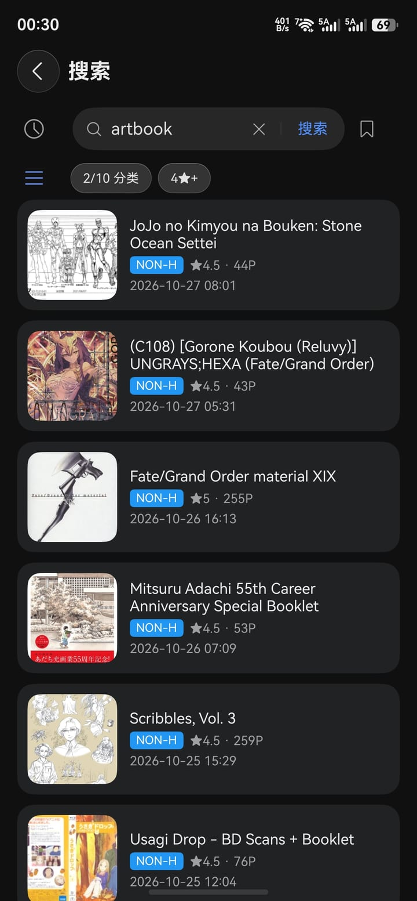
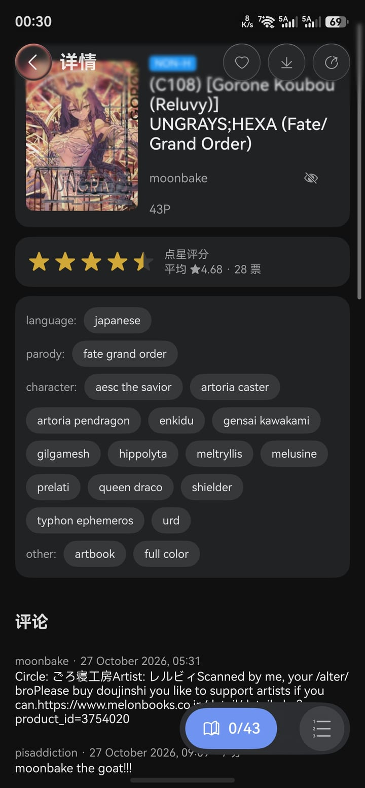
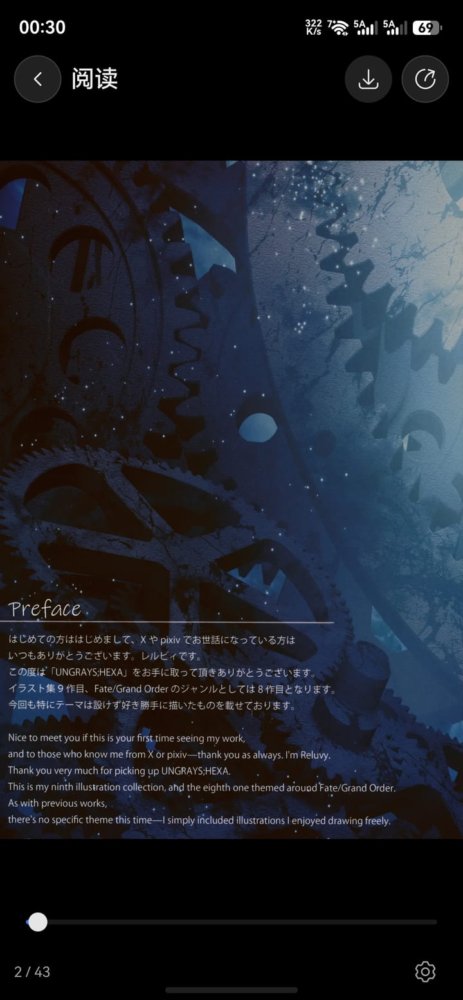

# EhViewer for HarmonyOS NEXT

E-Hentai / ExHentai 的 HarmonyOS NEXT 客户端，ArkTS / ArkUI 重写，非官方。

本项目是 [seven332/EhViewer](https://github.com/seven332/EhViewer)（Android 版，Apache-2.0）的
HarmonyOS NEXT 移植。与 E-Hentai / ExHentai 官方无关：只提供客户端功能，
不托管、不存储、不分发任何站点内容。

- 包名：`io.github.vaple.ehviewer`
- 目标平台：HarmonyOS NEXT（API 26 / HarmonyOS 6.0）

## 功能

- **站点**：E-Hentai / ExHentai 双站点切换；Cookie 登录，支持从浏览器复制整串 Cookie 导入
- **浏览**：首页热门、订阅（watched）、排行榜（含档位筛选）、搜索（支持站点语法与「搜索排除」规则）
- **详情**：封面、标签、评分、评论、云端收藏分类、预览图
- **阅读**：横向 / 纵向翻页、双击与双指缩放、阅读进度记忆、离线打开已下载画廊
- **历史**：浏览历史
- **下载**：逐页下载、断点续传、暂停 / 继续 / 删除、失败重试、后台长时任务 + 进度通知
- **诊断**：请求与解析日志脱敏落盘、崩溃收集、一键打包分享

## 截图

| 搜索 | 详情 |
| --- | --- |
|  |  |

| 阅读器 | 下载 |
| --- | --- |
|  |  |

## 下载与安装

发布页提供的是**未签名**的 hap（`ehviewer-<versionName>.hap`，附同名 `.sha256`）：

1. 下载 hap 与 sha256，先校验文件完整性
2. 用你自己的调试证书为它签名（HapKit、小白调试助手等自签工具都可以）
3. 签名后安装到已开启开发者模式的设备

未签名 hap 无法直接安装（会报 `9568320 no signature file`）。
签名证书与设备绑定，别人签好的包在你机器上装不上，所以本项目只分发未签名包。

## 从源码构建

需要 DevEco Studio（支持 API 26 / HarmonyOS 6.0）。

1. 用 DevEco Studio 打开工程根目录
2. File → Project Structure → Signing Configs → 勾选 **Automatically generate signature**
3. 选择设备，Run

仓库里的 `build-profile.json5` 的 `signingConfigs` 是**空数组**，签名配置由 DevEco 写在本地工作区，
请不要提交（`.githooks/pre-commit` 会在口令被暂存时报错）。

首次 clone 后启用提交守卫：

```
git config core.hooksPath .githooks
```

发布包（未签名）用 DevEco 的 Build → Build Hap(s) 选择 release 模式即可，
产物在 `entry/build/default/outputs/default/entry-default-unsigned.hap`。

## 测试

**本地单测**（不需要设备、不需要网络，覆盖解析器 / URL / 状态 / 服务层）：

```
<DevEco>/tools/hvigor/bin/hvigorw test --mode module -p module=entry@default -p buildMode=debug
```

> 注意：`hvigorw test` 的退出码恒为 0，判断成败要看日志里有没有
> `ERROR: Error in <用例名>`。

**设备集成测试**（需要真机 / 模拟器，且设备能直连 e-hentai.org）：

1. 构建并安装 `entry@ohosTest`
2. 拉起 App 后执行
   `aa test -b io.github.vaple.ehviewer -m entry_test -s unittest OpenHarmonyTestRunner -s timeout 60000`

这组用例以**未登录**身份访问公开页面，不需要任何账号或 Cookie。
`entry/src/test/fixtures/` 里是真实站点的 HTML 快照（含少量真实标题文本），
只用于解析器单测，不含任何图片或凭据。

## 目录结构

```
AppScope/                    应用级配置（包名、版本、图标）
entry/src/main/ets/common/   通用工具（日志、脱敏、错误文案）
entry/src/main/ets/model/    数据模型
entry/src/main/ets/network/  HTTP 客户端、站点 URL、Cookie
entry/src/main/ets/parser/   HTML / JSON 解析器
entry/src/main/ets/db/       RDB 表结构与 DAO
entry/src/main/ets/service/  图片缓存、下载、诊断、分享
entry/src/main/ets/state/    设置与窗口状态的 V2 状态容器
entry/src/main/ets/ui/       页面与组件
entry/src/main/resources/    资源、配色令牌、图标
entry/src/test/              本地单测（Hypium）
entry/src/ohosTest/          设备集成测试
```

## 隐私

- 账号 Cookie 只保存在应用沙盒（`preferences`），不上传任何第三方服务器
- 日志默认脱敏：Cookie、Authorization、apikey、pass_hash、cf_clearance 等一律以 `***` 落盘
- 诊断日志只有你在「设置 → 关于 → 诊断日志」主动分享时才会导出，导出包同样经过脱敏
- 整本下载只写入应用沙盒，不进入系统相册

## 免责声明

本项目仅用于学习与个人使用。请遵守站点服务条款与所在地区的法律法规。
所有内容的版权归原作者所有，本项目不提供、不存储、不分发任何内容。

## 许可

以 Apache License 2.0 发布，见 [LICENSE](LICENSE) 与 [NOTICE](NOTICE)。

移植自 Hippo Seven 的 EhViewer（Copyright (C) 2014-2019，Apache-2.0）。
